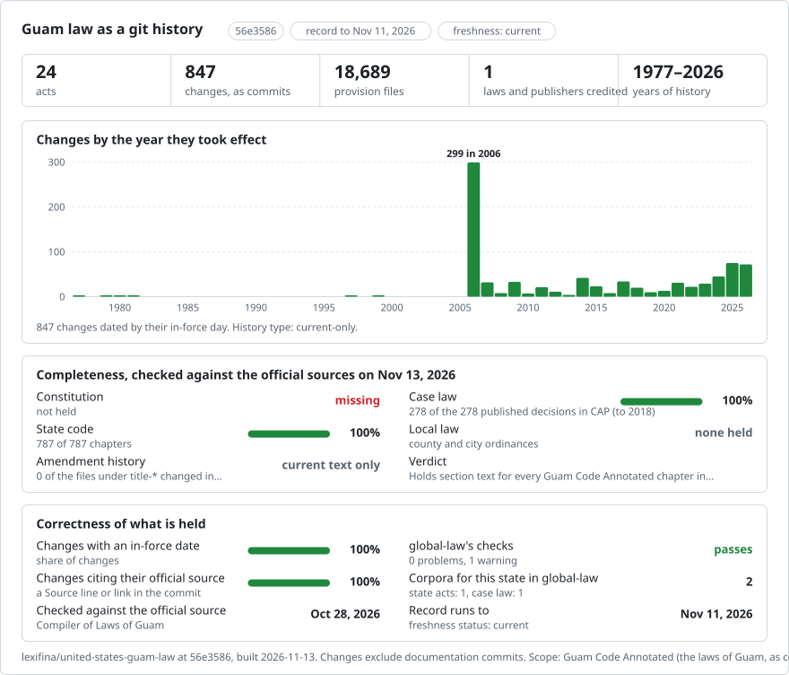

# The laws of Guam, as a git repository

<picture>
<source media="(prefers-color-scheme: dark)" srcset="data/effort-dark.svg">

</picture>

Part of [lexifina/global-law](https://github.com/lexifina/global-law), one git history for every country's law: this is the law of Guam, United States, which global-law reads at `united-states/guam/acts/`.

The Guam Code Annotated as a git repository: all 22 titles, in 824 chapters (and the divisions of Title 13, Part 4 of Title 20, the 2006 Guam Rules of Evidence, and the attachments, exhibits and probate forms the Code prints). The source is the [Guam Code Annotated](https://col.guamcourts.gov/guam-code-annotated/guam-code-annotated) published by the Office of the Compiler of Laws, which is part of the Judiciary of Guam. Its index says "Updated through P.L. 38-143 (Oct. 13, 2026)". There is one file per section (17,839 of them), with one paragraph per line, so `git blame` and `git diff` work line by line.

**What this repository is not, yet: a history.** The Compiler publishes only the current text of each chapter, as one PDF, and keeps no earlier versions. So each chapter is a single commit holding its whole current text. Nothing before that text can be rebuilt from this source, so there is no line-by-line history before the date the Compiler stamped on the chapter. New compilations will be added from now on as later commits, so the history grows forward from here. The amendment history the Code prints is kept: the SOURCE note under each section, naming each public law that added, amended or repealed it, is in the files and in [`data/amendments.csv`](data/amendments.csv).

The record holds 824 chapters, compiled between 2006-06-30 and 2026-10-26, in 831 commits. Four appended date corrections retain all original law-file bytes.

## A lawyer's questions as git commands

| Question | Command |
| --- | --- |
| What does 1 GCA § 1607 say? | `python tools/in_force_on.py 2026-10-29 "1 GCA 1607"` |
| The same, by folder | `python tools/in_force_on.py 2026-10-29 title-01/chapter-016 1607` |
| A whole chapter, in order | `python tools/in_force_on.py 2026-10-29 title-01/chapter-016` |
| A Guam Rule of Evidence | `python tools/in_force_on.py 2026-10-29 "6 GCA Rule 401"` |
| Which public laws a section's SOURCE note names | `grep '^SOURCE' title-01/chapter-016/1607.md` |
| Every section a public law touched, by the notes | `grep 'P.L. 27-077' data/amendments.csv` |
| Which sections cite § 1607 in their own text | `git grep -n '§ 1607' -- title-01` |
| What changed in a chapter since this build (after later builds) | `git log -p -- title-01/chapter-016` |
| When the Compiler last compiled each chapter | [`data/units.csv`](data/units.csv) |

Files sit at `title-NN/chapter-NNN/<section>.md` (Title 13, the Uniform Commercial Code, uses `division-NN`; Title 20 has `part-04`). A section's number is unique within its title, so `1 GCA § 1607` is `title-01/chapter-016/1607.md`. Where a chapter prints two sections with the same number (public laws sometimes added two, as with 1 GCA § 1026), the second is `1026-2.md`. Each chapter's `chapter.md` holds what the PDF prints before its first section: the chapter heading, the chapter's own SOURCE note and its list of sections. Its `index.txt` lists the files in the order of the chapter. A section file starts with any Article or Subchapter headings above it (`## ARTICLE 1 GENERAL PROVISIONS`), then the section's own line as printed (`§ 1607. Copyright.`), then its paragraphs, one per line: `(a) ...`, `(1) ...`. Last come the Compiler's notes, copied as printed: `SOURCE: GC § 42104, as added by P.L. 14-093:2 (Dec. 31, 1977). ...`, then any `NOTE:`, `2019 NOTE:`, `COMMENT:` or `COURT DECISIONS:` lines.

Three parts of the Code are split differently. The 2006 Guam Rules of Evidence (6 GCA, Appendix A) have one file per rule (`rule-401.md`), with the appendix's title page and table of contents in `appendix-a.md`. The official probate forms (15 GCA, Appendix A) have one file per form (`form-1.md`). 35 chapters print no section of their own, because they are repealed, vacant, reserved or moved (12 GCA Chapter 2, for example, lists where its articles went), or are a single form (the transfer-on-death deeds of 15 GCA Chapter 33). These are held whole in `chapter.md`.

## The dates, and which one we use

The Compiler prints a stamp at the foot of each page, such as `COL5/29/2026` or `COL 2026-05-29`: the day that chapter was last compiled. **Each commit is dated by that day** (the latest stamp in the PDF), at noon Chamorro Standard Time (UTC+10; Guam keeps no daylight saving time). The date is also in the `Consolidated:` and `In-force:` trailers. All 824 chapters have source compilation dates. Four Title 3 chapters (5, 8, 12 and 16) print `07312013` without a `COL` prefix: 31 July 2013. Labelled corrections replace their original retrieval-day baselines, with `Text-as-of`, `In-force-basis`, `Corrects`, `Supersedes` and `Redates`. The source notes cite P.L. 31-255:2 (Dec. 11, 2012), but legal commencement is not established. See [`data/date-corrections.json`](data/date-corrections.json). Some older stamps have seven digits and can be read two ways: `COL1242015` is 1/24/2015 or 12/4/2015. The build keeps the reading that fits the PDF's own save date (its ModDate, else its CreationDate): a stamp is never more than a day or two after it. When both readings fit, it uses the one closest to the save date and marks the commit `Date-note: ambiguous stamp`, with both readings in the message (18 chapters; `date_note` in [`data/units.csv`](data/units.csv)). It is a compilation date. It is not the date any public law took effect, and it does not prove the text was in force on that day. The SOURCE notes give each public law's date as printed beside it (the day it became law, as in `P.L. 27-077:1 (Apr. 26, 2004)`), and [`data/amendments.csv`](data/amendments.csv) lists that date where one is printed (10,523 of 13,546 citations). It does not convert one kind of date into the other.

`tools/in_force_on.py` answers for any date on or after a chapter's compilation date. For an earlier date it says there is no version, because the source has none.

## What "author" means

Every law-text commit has the same author, `Guam Compiler of Laws <compiler-of-laws@guamcourts.invalid>`, with the trailer `Kind: consolidated`. The address cannot exist. The author is the publisher of the compilation, not a lawmaker. No line is credited to a public law, because without the earlier text nobody can tell which words a public law wrote. The SOURCE notes say which public law added, amended, repealed or renumbered a section. They are kept as text and are not used to credit lines. In the shared design for these repositories, a change is credited to an amending law only when the source shows the text before and after it. When later compilations are added and the text changes, that change will be credited to a public law only where a new SOURCE note names one. Otherwise it is labelled `Kind: unexplained` and authored by the publisher.

There are 824 consolidated commits, 0 amendment commits and 0 unexplained ones. The SOURCE notes cite 3,173 distinct public laws in 13,546 citations; the latest cited is P.L. 38-143.

## What it does not show

- Any text before the current compilation. The Compiler keeps none online.
- The Organic Act of Guam (a federal law, 48 U.S.C. § 1421 and following), the Code's table of contents, its introduction and its subject indexes. The Compiler prints these as separate PDFs, and they are not law of Guam or not law at all.
- Public laws as enacted and comprehensive administrative-regulation and court-rule coverage. The additional compilations included in this record are listed below.
- The Great Seal on the Rules of Evidence cover (official PDF p. 5) and the inline image within 9 GCA section 67.801(c)(9) (official PDF p. 53) are unrepresented. The meaning of the latter is unresolved; that chapter is not certified image-complete. The layout of tables: a table's words and figures are kept as paragraphs of text, not as a grid. The running heads, page numbers and page stamps are left out.
- Public laws passed after the update the index names (P.L. 38-143 (Oct. 13, 2026)), and chapters the Compiler has not yet recompiled for an earlier law. A section's SOURCE note shows what the Compiler has worked in.

This is a research aid. The Compiler's PDFs are the published text, and for anything that matters read them, or the public laws themselves.

## How it is checked

`tools/build/` holds the build as it was run. [`data/source-sha256.tsv`](data/source-sha256.tsv) has the sha256 of the index page and every PDF the build read. The build is deterministic: from the same files it gives the same commit hashes. See [`REPRODUCE.md`](REPRODUCE.md). Before publishing, the build was checked for these things:
- the letters and digits of every chapter's files were compared with those of its PDF, read separately with PyMuPDF's plain text by a script that shares no code with the build (`tools/build/check_words.py`). Of 18.2 million letters and digits, 0.025% are in the PDFs but not here, and all of those that were inspected are running heads and page numbers. 0.007% are here but not counted on the PDF side, and nearly all of them are a chapter's running head that is kept in its `chapter.md`;
- the text `tools/in_force_on.py` prints for sample sections matches the PDF;
- every commit's trailers parse, every commit is at noon Guam time, and there are no merges, no ordinary version dates that go backwards and no dates after the build date (later corrections can name earlier compilation dates);
- two builds from the same files give the same HEAD.

## How it is built

The build reads the Compiler's index page and each chapter PDF it links, as retrieved. `parse.py` reads each PDF with PyMuPDF. It drops the running heads, page numbers and page stamps (keeping the stamps' dates), joins the lines of each paragraph, and notes which paragraphs are bold. `build.py` starts a new file at each bold section line (`§ 1607. Copyright.`), puts Article headings on the file below them, lists the SOURCE notes' public laws, and writes one commit per chapter with `git fast-import`. The original compilation build used no AI model. AI assistance in the appended date corrections was limited to metadata and reader tooling; the legal wording remains unchanged.

## Reuse

The laws themselves belong to nobody. Under the government edicts doctrine, as the Supreme Court of the United States applied it in *Georgia v. Public.Resource.Org, Inc.*, 590 U.S. 255 (2020), works that legislators and judges make in their official capacity cannot be copyrighted. That covers the statutes I Liheslaturan Guåhan enacts and the Rules of Evidence the Supreme Court of Guam promulgates. The same case held that annotations a legislature's own agent writes are not copyrightable either. It was decided on Georgia's facts, and the Guam Code's notes are written by the Compiler of Laws, an office of the Judiciary.

The Code itself claims a right to copyright the Compiler's work product. 1 GCA § 1607 says: "The government of Guam shall have the right to copyright or permit any appropriate private contractor to copyright any or all of the work product developed pursuant to this Chapter; ... provided, further, that the government of Guam shall not part with any rights to the form or structure of the laws, rules or other official documents of Guam". The Compiler's website terms also claim copyright in the site's content. They do not forbid automated access. So the statute text is free to use. The Compiler's arrangement and notes (the SOURCE notes, NOTES and COMMENTS) may be claimed by the government of Guam under § 1607, and whether *Georgia v. Public.Resource.Org* reaches them has not been decided. **This repository is private until that is settled.** See [`SOURCES.md`](SOURCES.md).

Lexifina's own contributions (the tools, the arrangement into files and the commit messages) are CC0. See [`LICENSE`](LICENSE).

## Additional official compilations

This record also contains 30 additional units from the Compiler of Laws administrative, banking and court rules listings. They are current-only texts kept whole in `text.md`, with source page headings and stamps retained. The two solid waste units filed in 1984 and 1986 use the last possible day under their 45-day commencement clauses; earlier legislative approval was not established. The invasive species fee unit uses March 11, 2022, when P.L. 36-87 lapsed into law; its effective-date clause says upon enactment. The Compiler cites March 12 beside the amendments, a one-day source disagreement. Its 2026 compilation stamp is recorded separately. No earlier versions are represented.

AI assistance for additional material was limited to software and metadata; official source words and punctuation are preserved.

[Additional units](data/additional-units.json) lists each title, official source, in-force evidence, compilation date and source digest. The Code chapter count above refers to the Code only. Other listed additional units remain outside this record pending source-date, text or image review.

The additional loan and fishing rules retain their source commencement clauses. 2 further units are listed below with dates established by the source text.

The pesticide chapter retains its textual fee table and source phased commencement clauses. 1 further units are listed below with dates established by the source text.

| Unit | In-force date | File |
| --- | --- | --- |
| Chapter 2. Initiative, Referendum and Legislative Submission | 2014-08-12 | [garr/06gr002](garr/06gr002/text.md) |
| Chapter 4. Public Official Financial Disclosure | 2014-08-12 | [garr/06gr004](garr/06gr004/text.md) |
| Chapter 6A - Senator Paul Bordallo Rules and Regulations for Chamorro Land Trust Commission Effective February 9, 2022 | 2022-02-09 | [garr/18gar00-6a](garr/18gar00-6a/text.md) |
| Chapter 2. Insurance Continuing Education | 2022-08-01 | [garr/12gr-002](garr/12gr-002/text.md) |
| Chapter 12. Tow Truck Regulations | 1999-01-01 | [garr/30gar002-12-doc](garr/30gar002-12-doc/text.md) |
| Chapter 1. Conduct of Elections | 2014-08-12 | [garr/06gr001](garr/06gr001/text.md) |
| Chapter 4B. Government of Guam Deferred Compensation Plan | 2018-01-01 | [garr/2-1gar04b](garr/2-1gar04b/text.md) |
| Chapter 6. Fair Employment Practice | 2018-07-25 | [garr/17gr01-006](garr/17gr01-006/text.md) |
| Chapter 56. Energy Efficient Products Mandate | 2020-01-18 | [garr/22gar011-56](garr/22gar011-56/text.md) |
| Chapter 4. Bank Organizations | 1977-09-26 | [garr/14gar001-4](garr/14gar001-4/text.md) |
| Chapter 7. Foreign Banking Corporation | 1977-11-08 | [garr/14gar001-7](garr/14gar001-7/text.md) |
| Chapter 5. Prohibited Practices, Sanctions | 1979-03-20 | [garr/14gar001-5](garr/14gar001-5/text.md) |
| Chapter 6. Branch Banks and International Banking Corporations | 1979-03-20 | [garr/14gar001-6](garr/14gar001-6/text.md) |
| Chapter 3. Banking Practices | 1980-04-01 | [garr/14gar001-3](garr/14gar001-3/text.md) |
| Chapter 2. Commissioner of Banking | 1981-01-08 | [garr/14gar001-2](garr/14gar001-2/text.md) |
| Chapter 9. Guam Board of Examiners for Optometry | 1997-05-06 | [garr/25gar001-9](garr/25gar001-9/text.md) |
| Interim Rules for Recording Grand Jury Proceedings (PRM08-002-1, effective July 16, 2008) | 2008-07-16 | [court/interim-20rules-20for-20recording-20grand-20jury-20proceedings-2007162008](court/interim-20rules-20for-20recording-20grand-20jury-20proceedings-2007162008/text.md) |
| Chapter 7. Temporary Alien Workers | 2009-07-20 | [garr/17gar007](garr/17gar007/text.md) |
| Traffic Court Rules for the Superior Court of Guam (Amended by PRM20-003-02, effective April 3, 2024) | 2024-04-03 | [court/traffic-20court-20rules-2020240403](court/traffic-20court-20rules-2020240403/text.md) |
| Chapter 2. Customs and Quarantine | 2013-08-01 | [garr/04gar001-2](garr/04gar001-2/text.md) |
| Chapter 4. Criminal Injuries Compensation Commission Rules and Regulation for the Adjudication of Victim Claims | 2025-08-18 | [garr/19gar004](garr/19gar004/text.md) |
| Chapter 11. Guam Board of Medical Examiners | 2025-08-18 | [garr/25gr011](garr/25gr011/text.md) |
| Chapter 3. Election Campaign Contributions and Expenditures | 2025-12-20 | [garr/06gr003](garr/06gr003/text.md) |
| Chapter 13. Guam Board of Examiners for Pharmacy | 2017-05-22 | [garr/25gar013](garr/25gar013/text.md) |
| Solid Waste Collection Regulations | 1986-07-31 | [garr/22gar004-21](garr/22gar004-21/text.md) |
| Beverage Container Regulations | 1984-09-30 | [garr/22gar004-22](garr/22gar004-22/text.md) |
| Invasive Species Inspection Fee | 2022-03-11 | [garr/08-gr04-014](garr/08-gr04-014/text.md) |
| Farmers' and Fishermen's Small Loan Revolving Fund | 1990-09-09 | [garr/08gar001-3](garr/08gar001-3/text.md) |
| Fishing Regulations | 1998-01-12 | [garr/09gar002-12](garr/09gar002-12/text.md) |
| Chapter 15. Pesticides | 2011-10-01 | [garr/22gar003-15](garr/22gar003-15/text.md) |
